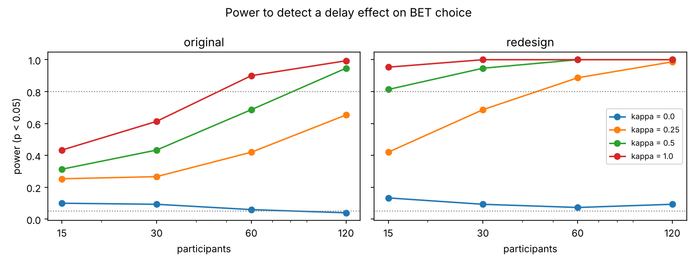

# Can This Experiment Detect Anticipatory Utility?

**Full paper: [paper/paper.pdf](paper/paper.pdf)**

Anticipatory utility is the idea that people value not just a reward, but the pleasure of waiting for it. I built a slot-machine task to test it during a 2025 MA research project at the Iigaya Lab (Columbia): participants choose a sure amount or an equal-expected-value bet, and a winning bet pays out after a machine-specific delay of 8, 12 or 16 seconds.

Before collecting data, this project asks whether that design could detect the effect at all. It simulates participants from a reinforcement-learning model with and without an anticipation term, then runs parameter recovery, model recovery and a power analysis. **No human data are used.**

**Result:** with the planned 30-person pilot and a moderate effect, the original design detects anticipatory utility in only **43%** of simulated studies. A redesign with wider delays (2/9/16 s) and more trials per machine reaches **95%** with the same 30 people.



## Run it

```bash
pip install -r requirements.txt
python scripts/01_parameter_recovery.py   # ~1 min
python scripts/02_model_recovery.py       # ~1 min
python scripts/03_power.py                # ~2 min on 2 cores
python scripts/04_example_study.py        # one simulated pilot, plotted
```

Seeds are fixed, so results reproduce exactly.

## Layout

```
paper/              LaTeX source and PDF
src/au/             task, models, maximum-likelihood fitting, designs, group analysis
scripts/            the four analyses
data/               the Gorilla task spreadsheet (trial list, not participant data)
figures/, results/  outputs
```
